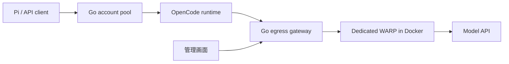

# OpenCode経由の推論経路・出口管理の調査

調査・検証日: 2026-10-05〜2026-10-06（JST）。対象CLIは `v1.18.34`、公式ソースのコミットは `aec0b9a6d8898f68f923aaf08b7306d931fd9d76`。2026-10-05の調査時の[最新公開リリース](https://github.com/anomalyco/opencode/releases/tag/v1.18.34)も同じバージョンだった。

## 推奨

Piの会話とツール定義を保つには、OpenCodeを「アカウント認証・接続設定の管理」と「1回の推論」に使う経路が適している。現在の `Session.Prompt` はOpenCodeのエージェント実行を開始するため、APIプロキシとして使うと履歴・ツール・終了条件の変換が多くなる。

短期は現在の認証経路を保ち、公式プラグインの履歴・システム変換で改善する。出口管理は実装・反映済み。初期の専用WARPではIP上限429とcooldownを確認し、後続のSurfshark WireGuard構成では異なる3出口で実モデルの生成成功を確認した。実アカウントのConsole設定とtoken・組織ヘッダーだけを使う最小HTTP要求は、MuseでHTTP 403 `FreeTierError` になった。したがって、Goから受信JSONを直接送る方式を無料モデルの実用経路としては採用しない。エージェントの二重実行を減らす長期候補は公式Provider・LLM層に単発推論口を設ける方式だが、その場合も上流の受理条件を維持できるか実機確認が必要となる。SDKの採否より、どの層を呼ぶかが重要となる。

OpenCode内HTTP中継の試作は入力項目とSSEを保てたが、接続先はローカル模擬APIであり、その試作での実OAuth・無料モデルの受理は未検証。別の実API試験では、最小要求による直接HTTPが拒否された。本番の推論経路は `Session.Prompt` とMCPを維持し、OpenCodeが実際に生成したHTTP要求に出口管理を追加している。クライアントの要求をそのまま上流へ送る方式には切り替えていない。

## 候補の比較

| 経路 | 履歴・ツール・パラメーター | OAuthとの接続 | 導入・保守 | 確認状況 |
| --- | --- | --- | --- | --- |
| 現在: Go SDK → `Session.Prompt` → MCP | 履歴をユーザーのJSON transcriptへ変換。ツールをMCPとして登録し、実行前の権限要求で停止 | 既存OpenCodeに任せる | CLI変更不要。権限・中断・ツール名の変換が必要 | Piの実API往復を確認。WARPで上流429、後続Surfsharkの3出口で実モデルHTTP 200、Pi両APIのSSE・ツール結果往復を確認 |
| GoのHTTP → 同じSession API | SDKを外しても上と同じエージェント動作 | 既存OpenCodeに任せる | SDK依存は減るが、今回の互換性問題は解消しない | 公式HTTP APIの解析 |
| 公式プラグイン → 履歴・システム変換 → `Session.Prompt` | user/assistant/toolの履歴とcall IDをネイティブ形式に戻せる。内蔵ツールとエージェント動作は残る | 既存OpenCodeに任せる | CLI変更不要。experimental hookの追従が必要 | 実CLI＋模擬上流で成功 |
| OpenCode内のプラグインHTTP中継 → モデルAPI | 対応するプロトコルならJSONの項目とSSEを直接中継できる。モデル別名は解決する | 実行中のOpenCodeから解決済みProvider設定を取得する候補。汎用OAuthのfetch関数は公開JSONに出ない | CLI変更不要。認証更新、組織ヘッダー、API方式の検証が必要 | Chat/Responsesを模擬上流で成功。実OAuth・無料モデルは未検証 |
| OpenCodeに単発推論口を追加 → Provider → LLM | agentの履歴管理・内蔵ツール・MCPを通さず、クライアントの会話をLLMへ渡せる。Provider別の変換は残る | 公式のアカウント・設定・Provider解決を再利用 | CLIの小さな派生ビルドが必要。上流変更に追従 | ソース上の実現性を確認。未実装 |
| Go → 解決済みの `/inference/*` APIを直接呼ぶ | 軽量な直接中継の候補だったが、最小要求は無料モデルの受理条件を満たさなかった | Console token・組織ヘッダー・remote configを使用し、OAuth更新と失効をGo側で扱う | CLI常駐を省くには受理条件も解決する必要がある | Muse ResponsesはHTTP 403 `FreeTierError`。そこで停止し、big-pickle Chatは未送信 |

公開Session APIはユーザーメッセージの保存とエージェントのループを扱う。`format:json_schema` は内部のStructuredOutputツールと `toolChoice:"required"` を追加するため、単純なOpenAI API転送口にはならない。[公式Session実装](https://github.com/anomalyco/opencode/blob/aec0b9a6d8898f68f923aaf08b7306d931fd9d76/packages/opencode/src/session/prompt.ts#L1243)

LLM層には解決済みのモデル・Provider、messages、tools、toolChoice、トークン上限、ヘッダーを渡す入口がある。これを単発で公開する設計は可能と判断した。これはソースからの設計上の推論であり、公開された単発生成APIの存在を示すものではない。[公式LLM実装](https://github.com/anomalyco/opencode/blob/aec0b9a6d8898f68f923aaf08b7306d931fd9d76/packages/opencode/src/session/llm.ts#L224)、[Provider.getLanguage](https://github.com/anomalyco/opencode/blob/aec0b9a6d8898f68f923aaf08b7306d931fd9d76/packages/opencode/src/provider/provider.ts#L1918)

`@opencode-ai/llm` は同じリポジトリ内のprivateパッケージで、ネイティブLLM実行も実験的な経路。単独で入れるだけでOpenCodeアカウントの認証や公開APIが揃うSDKではない。[package.json](https://github.com/anomalyco/opencode/blob/aec0b9a6d8898f68f923aaf08b7306d931fd9d76/packages/llm/package.json)、[実験的実行とフォールバック](https://github.com/anomalyco/opencode/blob/aec0b9a6d8898f68f923aaf08b7306d931fd9d76/packages/opencode/src/session/llm.ts#L224)

## アカウント認証を保つために必要なもの

OpenCodeはactive accountとactive organizationからremote configとtokenを取得する。tokenを `OPENCODE_CONSOLE_TOKEN` として設定し、remote configを通常のProvider設定に統合する。[公式設定ローダー](https://github.com/anomalyco/opencode/blob/aec0b9a6d8898f68f923aaf08b7306d931fd9d76/packages/opencode/src/config/config.ts#L492)

既存のreadyプロフィール2件について、Consoleの `GET /api/config` を読み取り専用で確認した。両方ともHTTP 200で、`opencode` Providerは次の構成だった。

- `options.apiKey` は `OPENCODE_CONSOLE_TOKEN` を参照するテンプレート。
- `x-opencode-org-id` ヘッダーを持つ。
- モデル定義は81件。

続く読み取りで、実アカウントのProvider接続先は `https://opencode.ai/inference/openai/v1` だった。モデル定義には `https://opencode.ai/inference/anthropic/v1` と `https://opencode.ai/inference/google/v1beta` への個別指定も存在した。記録は `.state/research/routes/console-endpoint-metadata.json` にある。

この設定取得ではtoken refreshやモデル生成を行っていない。直接HTTPの候補には、解決済みConsole token、組織ヘッダー、対象モデルの `/inference/*` 接続先が必要となる。後述の生成試験では、それらを正しく解決した上で最小要求を送ったが、無料モデルの利用条件で拒否された。接続設定の取得成功と無料推論の受理は別の結果として扱う。

## 実験で確認できた範囲

### ネイティブ履歴への変換

公式の `experimental.chat.messages.transform` と `experimental.chat.system.transform` を通常の `opencode serve` プロセスで使用した。模擬上流が受けたroleは `system → user → assistant → assistant → tool → user`。assistantのtool call、元のcall ID、クライアント側tool resultを保持できた。

システム指示は既定の9,624 bytesから指定した19 bytesへ置き換わった。ただし内蔵ツール11件は残った。システムや履歴の置換だけで透過中継になるわけではなく、ツール公開・停止動作を別途扱う必要がある。[公式messages hook](https://github.com/anomalyco/opencode/blob/aec0b9a6d8898f68f923aaf08b7306d931fd9d76/packages/opencode/src/session/prompt.ts#L1255)、[公式system hook](https://github.com/anomalyco/opencode/blob/aec0b9a6d8898f68f923aaf08b7306d931fd9d76/packages/opencode/src/session/llm/request.ts#L62)

検証記録: `.state/research/routes/replay-report.json`。模擬上流のみで、無料モデルの受理・品質はこの試験の対象外。

### プラグインHTTP中継

OpenCodeプロセス内でBunのHTTPサーバーを起動し、`/v1/chat/completions` と `/v1/responses` の要求を模擬上流へ中継した。`Session.Prompt` を使わず、モデル別名の解決を除く入力項目とSSEのbytesを保持できた。

試作の認証解決はローカルProvider fixtureで確認した。公開Provider JSONにはfunction型のfetch overrideが含まれないため、この仕組みをすべてのOAuth Providerへ一般化したわけではない。実アカウントのremote config、更新後のtoken、無料モデル、Piの複数ターンでの受理は次の検証対象となる。

検証記録: `.state/research/routes/http-bridge-report.json`。本番経路の変更なし。

### 実OAuthアカウントによる最小直接HTTP

既存のreadyプロフィール `live-test-001` のnative SQLiteを読み取り専用で開き、期限内のaccess tokenとactive organizationを取得した。tokenの更新・回転は行っていない。Consoleの `GET /api/config` はHTTP 200で、環境変数テンプレートから実際のConsole tokenを解決できた。

Docker内の専用WARPが `opencode.ai` 向けにhealthy、`warp=on`、公開IP `104.28.238.115` と確認された状態で、実際の `/inference/openai/v1/responses` へ1件送信した。

- モデル: `muse-spark-1.3-contributor-free`。Console定義から上流モデルIDを解決。
- 認証: 解決済みConsole bearer tokenと `x-opencode-org-id`。
- 本文: user input、`max_output_tokens:128`、`stream:false`。返答指示は `RAW_ROUTE_OK` のみ。
- OpenCodeのagent system、内蔵ツール、`x-opencode-*` クライアント識別ヘッダーの追加は行わなかった。
- 結果: HTTP 403、`FreeTierError`。メッセージは `OpenCode's free tier can only be used from within OpenCode`。

拒否を受けた時点で試験を停止した。予定していたbig-pickle Chatは送らず、再試行や指紋の補充も行っていない。前後のWARP healthは同じIPで正常だった。本番アプリ・アカウント・Docker設定の変更はない。

この結果から、MuseについてはConsole tokenと組織情報だけでクライアントの最小要求を直接中継する経路を採用できないと判断した。big-pickleへ一般化した結果ではなく、403を発生させる個別条件もこの試験だけでは分離していない。OpenCodeプロセス内でHTTPサーバーを起動するだけで、その条件を満たすとも判断できない。

検証スクリプト: `.state/research/routes/direct-api-probe.mjs`。秘密情報を除いた結果: `.state/research/routes/direct-api-report.json`。

## 参考プロジェクトから取り入れる部分

[`opencode-ip-rotator`](https://github.com/alztrk/opencode-ip-rotator/tree/fd8d86ff06c5320fb11d28e86717154ba63603c5) はWARPのネットワーク名前空間とモデル通信の出口を揃え、出口の確認・交換と実行中ストリームの保護を分けている。確認したコミットでは上流429と `Retry-After` を返し、429を一律に自動ローテーションの契機にはしていない。READMEの概略だけでなく、実際の分岐を確認した。[上流429の処理](https://github.com/alztrk/opencode-ip-rotator/blob/fd8d86ff06c5320fb11d28e86717154ba63603c5/server.py#L614)

[`pi-freeflow`](https://github.com/trefeon/pi-freeflow/tree/0ceb0a8f9da6478ff07cbeac97e262280d769aa9) は会話を同じrelayへ寄せる方式、出口の分散、障害・429時のcooldown、状態の復旧を備える。これらは出口プールの設計に参考になる。[出口の状態管理](https://github.com/trefeon/pi-freeflow/blob/0ceb0a8f9da6478ff07cbeac97e262280d769aa9/src/relay-state.ts#L458)

同時に、pi-freeflowはZen向けにツールの補充・名前の変換・streaming設定の変更も行う。「受信JSONを完全にそのまま送る」実装ではない。今回の目的では、この互換処理をまとめて移植するより、実際のOpenCodeが組み立てた要求の出口を管理する方が、既存認証・モデル固有の設定を維持しやすいと判断した。[Zen向け互換処理](https://github.com/trefeon/pi-freeflow/blob/0ceb0a8f9da6478ff07cbeac97e262280d769aa9/src/opencode-fingerprint.ts)

## 初期のDocker内専用WARPでの出口管理

推論経路の改善とIP出口の管理は独立に進められる。今回選んだ構成では、OpenCodeのモデル向けfetchをGoのローカル出口ゲートウェイへ渡し、ゲートウェイからDocker内の専用WARPを通して上流へ接続する。ネイティブ要求の本文・認証・モデル用ヘッダーを保ち、出口の選択だけを集中管理する。対象は従来の `/zen/*` に加え、実アカウントで確認した `/inference/*` を含む。

HTTP出口ゲートウェイ、429のcooldownと限定再試行、管理画面の設定・IP確認・交換操作は実装・反映済み。`/inference/*` の実モデル要求が専用WARPを通り、出口カウンターと実上流の `FreeUsageLimitError` HTTP 429を記録した。

今回の公開IPは既に無料枠の上限に達していた。同じIPのcooldownをSQLiteへ保存し、再要求には上流へ送らずHTTP 429と `Retry-After` を19msで返した。記録は `.state/server/egress-rate-limit-result.json` にある。この応答の期限は `2026-10-06 00:00 UTC`、日本時間では同日09:00であり、UTC日付の更新に対応していた。実際の上流応答を基準に扱い、すべての制限が同じ時刻に解除されるとは仮定しない。

このWARP検証で確認できたのはWARPを通る実要求、上流の拒否、制限の永続化と即時通知まで。WARP経由での成功したモデル生成・実モデルのSSE完了は、このIPの上限により未確認。Goのテスト・vet、模擬上流によるSSE・切断・同一IPの休止共有、実OpenCodeプロセスの上限通知コールバック統合テストは通った。管理画面も配信中のassetsをCloakBrowserで確認した。

このWARP検証時の出口設定は `sticky`、専用WARPを使用、`allow_direct_fallback:false`。WindowsのWARPは手動切断状態を維持し、Docker内の専用WARPはhealthyだった。後続の利用者指定により、現在は独立したSurfshark WireGuardコンテナー3個を `spread` で使用する。直通fallbackは引き続き無効で、旧WARPの記述は無効化して保持した。接続先ごとの公開鍵、新しいhandshake、異なる対象向け公開IP、実モデルの生成成功は[Surfsharkの報告](surfshark.md)にまとめた。

出口設計では次を扱う。

- 実際の外向き通信で確認したIP、接続状態、稼働中の要求数を管理する。
- 名前が異なる出口でも同じ公開IPなら同じ制限状態として扱う。
- 429では `Retry-After` とエラー内容を保持し、対象の出口・モデルをcooldownする。
- アカウントの失効・残高・契約・組織・モデル全体の制限を、IPの状態から分ける。
- 出口を交換する際は新規要求を止め、実行中のSSEが終わってからWARPを再接続する。
- 再接続後にIPを確認する。同じIPが再割当てされた場合は交換成功として扱わない。
- 再試行は応答の送信開始前に限定し、回数を制限する。途中まで返したSSEを最初から再実行しない。
- WARPを必須にした設定では、停止時に通常回線へ暗黙に戻さない。

専用WARPの今回の測定では、公開IPは `104.28.238.115` だった。再接続と新規登録2回でも同じIPが割り当てられた。WireGuardを試した後はMASQUEへ復帰した。接続自体が成功してもIP交換が成功したことにはならず、今回の結果では一つの固定した出口として扱う。

専用WARPを複数起動しても、常に異なる公開IPになるとは限らない。IPを実測して状態を共有する必要がある。ひとつの出口を何百アカウントで共有する場合、アカウント数とIP単位の利用可能量は別の指標になる。

公式Consoleソースには、匿名利用をIP単位、それ以外をkey単位で制限する経路がある。[制限方式の選択](https://github.com/anomalyco/opencode/blob/aec0b9a6d8898f68f923aaf08b7306d931fd9d76/packages/console/app/src/routes/zen/util/handler.ts#L142)、[IP単位の実装](https://github.com/anomalyco/opencode/blob/aec0b9a6d8898f68f923aaf08b7306d931fd9d76/packages/console/app/src/routes/zen/util/ipRateLimiter.ts)

一方、同じハンドラーには新しいinferenceサービスへの中継が先に存在する。公開されている旧IP limiterだけでは、現在のすべてのモデル・アカウントの制限を説明できない。429を受けた事実だけでIP制限と断定せず、応答の種別・モデル・出口・アカウントを記録する設計が必要となる。[先行するinference中継](https://github.com/anomalyco/opencode/blob/aec0b9a6d8898f68f923aaf08b7306d931fd9d76/packages/console/app/src/routes/zen/util/handler.ts#L107)

## 何百アカウントへの適用

登録したアカウントの数に合わせてCLIやWARPを常駐させる必要はない。アカウントはSQLiteと個別プロフィールに保存し、認証済みCLIは同時実行枠分だけ遅延起動する。WARPの出口プールはアカウントプールと別に持つ。

これにより、数百アカウントを保持しても、実行中CLI数・出口数・生成の同時実行数を独立に制御できる。直接API経路を採用すればCLIの数をさらに減らせる可能性があるが、認証更新と接続設定の責務が移るため、実機確認を終えるまでは軽量化の見込みとして扱う。

今回、現在の認証経路を保つ出口管理を実装し、WARPで `/inference/*` の実上流429・永続化・即時通知を確認した。後続のSurfshark構成では3出口で実モデル生成が成功し、Pi両APIのSSE・ツール結果往復も確認した。接続と同一サーバー再接続の実測は [Surfsharkの設定と実測](surfshark.md) に記録した。今後の経路改善候補は、ネイティブ履歴の実モデル試験と、Provider・LLMを再利用する単発推論口の設計・受理条件の確認となる。最小直接HTTPは拒否を記録して調査を止めており、無料モデルの本番経路として切り替えない。OpenCode内HTTP中継は、受理条件を維持できることが確認できた場合の候補として残す。
