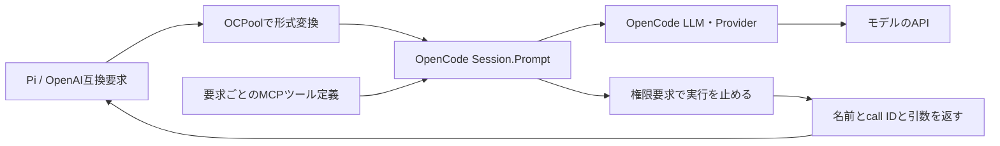

# OpenCodeのリクエスト経路とMuseのtool_choiceエラー

2026-10-05。対象はインストール済みCLIと同じ `v1.18.34`、コミット `aec0b9a6d8898f68f923aaf08b7306d931fd9d76`。公式リポジトリを `.state/research/opencode-src` にチェックアウトして解析した。

## 原因

失敗したモデルは `opencode/muse-spark-1.3-contributor-free`。要求ログに、auto以外のtool_choiceを受け付けないという上流エラーが記録されていた。

以前のOCPoolはクライアントのツールをネイティブのツール定義として渡さず、`Session.Prompt` に `format:json_schema` を付けて「テキストとtool_callsを含む構造化結果」を生成させていた。OpenCodeはこの指定を受けるとStructuredOutputツールを追加し、`toolChoice:"required"` を設定する。Pi自身がautoを送っていても、この時点で上流要求が変わっていた。

原因となった箇所は [session/prompt.ts](https://github.com/anomalyco/opencode/blob/aec0b9a6d8898f68f923aaf08b7306d931fd9d76/packages/opencode/src/session/prompt.ts#L1243) と [toolChoiceの指定](https://github.com/anomalyco/opencode/blob/aec0b9a6d8898f68f923aaf08b7306d931fd9d76/packages/opencode/src/session/prompt.ts#L1285)。モデル名だけを見て、すべてのモデルで同じ強制ツール選択が使えると判断してはいけない。

## SDKは透過プロキシではない

採用SDKの `Session.Prompt` は、OpenAI形式のJSONをそのままモデルへ中継するAPIではない。OpenCodeのユーザーメッセージを作成してエージェントのループを開始する。システム指示、ツール、履歴はOpenCodeが組み立て、プロバイダー別の形式へ変換する。



解析箇所:

- [公開Session API](https://github.com/anomalyco/opencode/blob/aec0b9a6d8898f68f923aaf08b7306d931fd9d76/packages/opencode/src/server/routes/instance/httpapi/groups/session.ts): SDKの入口。
- [LLMリクエスト組み立て](https://github.com/anomalyco/opencode/blob/aec0b9a6d8898f68f923aaf08b7306d931fd9d76/packages/opencode/src/session/llm/request.ts): システム指示、モデルvariant、ツール、ヘッダー。
- [LLM実行](https://github.com/anomalyco/opencode/blob/aec0b9a6d8898f68f923aaf08b7306d931fd9d76/packages/opencode/src/session/llm.ts): AI SDKとネイティブLLM経路、toolChoiceの受け渡し。
- [プロバイダー変換](https://github.com/anomalyco/opencode/blob/aec0b9a6d8898f68f923aaf08b7306d931fd9d76/packages/opencode/src/provider/transform.ts): 推論設定、履歴、モデル別パラメーター。

内部パッケージ `packages/llm` にあるChat/Responsesのプロトコル実装は、OpenCodeが上流APIを呼ぶための実装であり、Go SDKで呼べる透過中継エンドポイントではない。

## 修正した経路

`format:json_schema` とStructuredOutputによるツール代行を削除した。受信したfunction toolsのJSON Schemaを、認証付きのループバックMCPからOpenCodeへ登録する。OpenCode標準のツール選択を使うため、アプリがrequiredを上流へ追加しない。

[session/tools.ts](https://github.com/anomalyco/opencode/blob/aec0b9a6d8898f68f923aaf08b7306d931fd9d76/packages/opencode/src/session/tools.ts#L390) では、MCPツールの実行前に権限確認が入る。この時点でOCPoolがネイティブ実行を止め、完成した呼び出しをクライアントへ返す。[processor.ts](https://github.com/anomalyco/opencode/blob/aec0b9a6d8898f68f923aaf08b7306d931fd9d76/packages/opencode/src/session/processor.ts#L200) の停止条件も確認した。MCP側は実行機能を持たず、定義の提供だけを行う。

MCPは要求の終了時に切断する。切断に失敗したOpenCodeプロセスは再利用しない。定義の混在を避けるため、1つのプロセスが同時に扱う生成は引き続き1件。

## 残っている変換・制約

- OpenCode側にはエージェントのシステム指示と内蔵ツールが存在する。APIでこれらを実行する要求は拒否する。
- 会話履歴は現状、ロールとtool call IDを含むJSON transcriptとしてユーザーパートへ渡す。完全なネイティブ履歴への無損失変換ではない。
- MCPの名前空間を付け、応答時に元の名前へ戻す。長いツール名はプロバイダーの64文字制限に収まる別名にする。call IDと引数の値は保持する。
- required・名前指定は、公開するツールと指示・応答検証による制約。上流の選択はautoであり、強制選択を保証しない。
- `parallel_tool_calls:false` の件数も応答時に検証する。
- 推論強度、トークン上限などはモデルの対応範囲に依存する。

## 検証

MuseでPiの送信・解析実装を使い、ResponsesとChat Completionsの両方について、autoでreadを要求 → クライアント側のfixture結果を返す → その内容を回答する、まで成功した。以前のrequiredエラーは再発しなかった。

```powershell
$env:OCPOOL_SMOKE_MODEL='opencode/muse-spark-1.3-contributor-free'
node scripts/smoke-pi.mjs --auto-tools
```

GoではMCP認証、JSON Schemaの受け渡し、サーバー側実行の禁止、ネイティブcall IDの保持、複数の権限要求がまとめて停止される場合の呼び出し回収、長いツール名を検証する。ネイティブ統合テストでは実際のOpenCodeからMCPへ接続・切断する。
